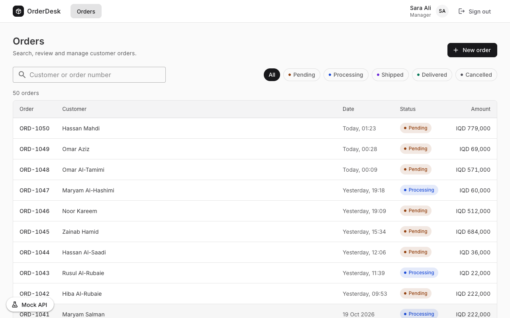
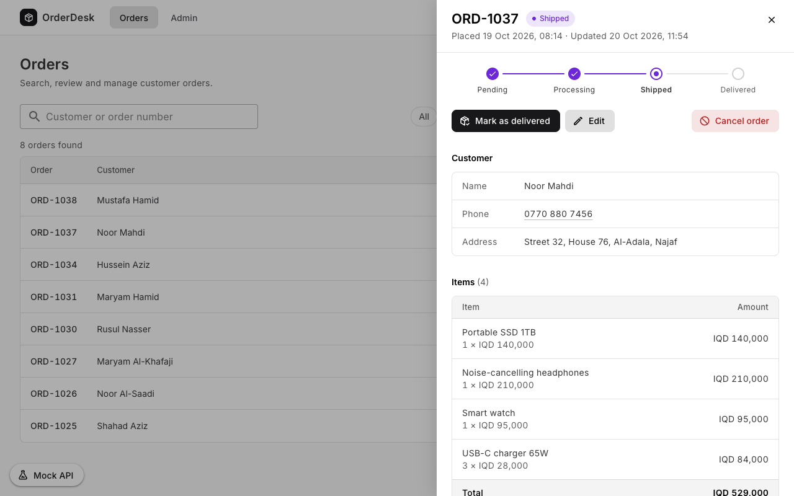
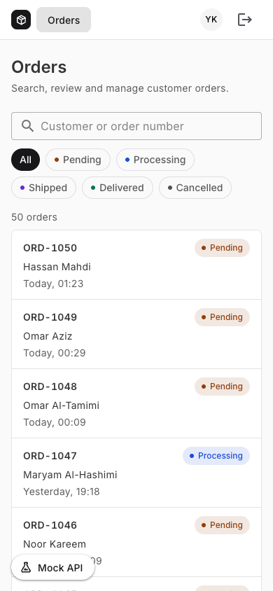

# OrderDesk: order management screen

An order-management screen in **Vue 3 (Composition API) and TypeScript**, built with **Vuetify**.
It runs in the browser against a mock API built with `axios-mock-adapter`, which enforces the same
permission rules as the UI, adds 300–1000 ms of latency to every response, and can be told to fail.



| Order details (admin) | Phone (support, no amounts) |
| --- | --- |
|  |  |

The [project report (PDF)](docs/project-report.pdf) maps each requirement in the brief to the
passing tests that prove it, with the latest test results. The two-page
[stack and decisions (PDF)](docs/stack-and-decisions.pdf) explains the libraries and the reasoning
behind them.

## Setup

Requires Node 22.18+ or 24.12+.

```bash
npm install
npm run dev     # http://localhost:5173
npm test        # Vitest + Testing Library
npm run build   # type-check + production build
npm run lint    # oxlint + ESLint
```

Tests are in `tests/`. `tests/permissions.test.ts` covers what each role can see and do, pages
opened by typing their URL, and how the UI handles the API's 403s.

### Test users

All three use the password **`password123`**. The sign-in page can fill them in for you.

| Role | Email |
| --- | --- |
| Admin | `admin@example.com` |
| Manager | `manager@example.com` |
| Support | `support@example.com` |

The **Mock API** panel (bottom left) makes the next order request fail with a 500, a network error,
a 401, a 403 or a 422, then switches itself off, so you see both the error and the recovery. Reads
fail twice, to get past their one automatic retry.

## Permission model

The UI checks **permissions, never roles**. `GET /me` returns the permission list and code asks
`session.can('orders.cancel')`. Roles exist only on the server (`src/mocks/users.ts`), so a new
role needs no client change. A new permission is added to `src/features/auth/permissions.ts` and
used to gate a route or a control.

- **Routes:** a guard checks `meta.permissions`. Typing `/admin` without `admin.access` shows "no
  access", and the page's code is never downloaded.
- **Hidden vs disabled:** an action the user has no permission for is hidden, because it never
  applies to them. An action they may do but the order's state blocks (a delivered order) is shown
  disabled, with the reason on screen, so nobody wonders where the button went.
- **API:** the mock enforces everything again. It returns 401 for a missing or unknown token, 403
  for a missing permission, 409 for any change to a delivered or cancelled order (even as Admin),
  and 422 with one message per field. Users without `orders.view_amount` never receive amounts.
- **401 vs 403:** a 401 ends the session. The token, cached data and in-flight requests are
  dropped, so the next user sees nothing of the previous one. A 403 doesn't sign the user out: the
  error is shown and `/me` is re-read in case their permissions changed.
- **One rule beyond the brief:** creating or editing an order also needs `orders.view_amount`.
  Orders carry prices, and a role that can't see them shouldn't be able to overwrite them.
- **Status changes** go pending → processing → shipped → delivered, one step at a time. Cancelling
  is a separate action with its own permission.

### Connecting a real backend

Set `VITE_API_BASE_URL` (see `.env.example`) and the mock is never loaded. The client expects the
endpoints listed in `src/mocks/index.ts`, `GET /me` returning `{ id, name, role, permissions }`,
and errors shaped `{ message, code?, errors? }`. In production I'd move the token from
`localStorage` to an httpOnly cookie; that change stays inside `src/api/http.ts` and
`src/features/auth`.

## Key decisions and libraries

| Concern | Choice | Why |
| --- | --- | --- |
| UI | Vuetify 4 | Accessible fields, dialogs (focus trap, scroll lock), snackbars and tables, so the custom code is about orders, not widgets. Its theme and global defaults keep the look in one place |
| Forms | TanStack Form | Form state and when to validate (on submit, then as you type). A 422's errors land under their fields and stay with their line item when another one is removed |
| Server state | TanStack Vue Query | Each search has its own cache entry, so a slow older response can't replace newer results. Also gives cancellation, refetching after writes, and one `clear()` on sign-out |
| Session | Pinia (one store) | Who is signed in and what they may do |
| HTTP | axios | Interceptors attach the token and turn every failure into one typed `ApiError`. Required by the mock adapter |
| Validation | zod | One schema for the form and the mock, so 422 field paths match the form's fields |
| Phone numbers | libphonenumber-js | Knows which Iraqi numbers are mobiles, in any notation, and stores them in one format |
| Mock routes | path-to-regexp | Route patterns like `/orders/:id` for the mock API |
| Utilities | VueUse, MDI icons | Event listeners that clean up after themselves; icons as tree-shaken SVG paths |
| Tests | Vitest + Testing Library | UI tests render the whole app against the mock and act like a user; contract tests call the mock API directly |

- **Filters and panels live in the URL** (`/orders/12?status=pending`), so reloading, Back and
  shared links all work. Details, create and edit open in a side panel over the list.
- **Fast typing:** search waits for a 300 ms pause, and results are cached by search text, so the
  list always matches what's in the box.
- **One form** for create and edit. It validates on submit, then as you type. Server 422 errors
  appear under the matching field.
- **Global styles:** each look is defined once. Colours (one per order status too) and component
  defaults (field style, button shape, card border) are in `src/plugins/vuetify.ts`; the few shared
  rules Vuetify has no utility for are in `src/assets/main.css`. A style only one component uses
  stays scoped to it.
- **No hand-written regex:** phone numbers go through libphonenumber-js, email through zod, amounts
  through Vuetify's number input and mock routes through path-to-regexp. The only patterns left
  are Vue Router's route params: `:id(\d+)` only lets numeric ids into the order routes, and
  `(.*)` catches every other address for the 404 page.
- **Loading:** each loader sits on what's loading. Skeletons have the shape of the table, phone
  list, details panel and form they stand in for, so nothing moves when data arrives. A search or
  filter puts a bar along the top of the results (not in the search box), and a page or panel
  still downloading puts one under the app bar. Buttons spin while their action saves.
- **Accessibility:** a table on desktop and a list on phones. Everything works by keyboard, and focus
  returns to the order's row when a panel closes.
- **Mock data:** 50 deterministic orders kept in `localStorage`, so changes survive a reload.

## What I'd improve next

- Server-side pagination and sorting.
- Optimistic status updates with rollback.
- A CI pipeline (GitHub Actions) running lint, type-check, tests and build on every push.
- Playwright end-to-end tests in CI, for real focus and dialog behaviour across browsers.
- Arabic with right-to-left layout (the CSS already uses logical properties).
- Cookie-based auth with expiring tokens and silent refresh.
- Iraq-only metadata for libphonenumber-js, to shrink its ~34 KB (gzipped) chunk to a few KB.

## Time spent

About 5 hours in one session:

- ~45 min reading the brief and deciding on the stack and the approach.
- ~1 h setting up the project and building the features.
- ~2.5 h reviewing and testing what was built, and fixing what came up. Fixes from the earlier
  reviews went into the commits they belonged to, so the history reads feature by feature. The
  last review's fixes are separate commits, one per fix.
- ~45 min on this README, the screenshots and the two PDFs.

## AI assistance

I used Claude Code with Opus 5.5 at high effort. I started in plan mode, so nothing was built until
I'd approved the plan, then switched to auto mode for the implementation.

The main prompts I used for this project:

> The brief is in `Frontend_Take_Home_Task.pdf` in the repo root. Read it first and cover
> everything in it. I'm not going to repeat it here, this is just the stuff it leaves open and how
> I'd like it done.
>
> Stack (check the current versions on npm, don't go from memory):
>
> - create-vue scaffold with ts, router, pinia, vitest, eslint and prettier. Keep it recognisable
> - TanStack Vue Query for server state. Pinia is only for the session (token, user, permissions),
>   and just one store
> - axios + axios-mock-adapter. One zod schema shared by the form and the mock, so the 422 paths
>   line up with the fields
> - Vuetify for the UI and TanStack Form for the forms
> - If a style is used in more than one place, make it global
> - Use a Zod schema for regex instead of writing them by hand
> - VueUse
> - Vitest + Testing Library, rendering the whole app against the mock. I don't want shallow unit
>   tests
>
> Things I care about:
>
> - Check permissions, never roles. No permission means the action is hidden. If you're allowed
>   but the order's state blocks it (delivered/cancelled), show it disabled with the reason.
> - The mock should behave like a real backend: errors checked in a consistent order, allow-list
>   serializers so amounts can't leak by accident, data in `localStorage`, a deterministic seed.
> - When I force a failure I want a reviewer to see the error and then the recovery.
> - A 401 ends the session cleanly. No stale cache, and no late responses leaking to whoever signs
>   in next. A 403 never logs you out.
> - Filters and the open panel go in the URL, so back, refresh and shared links all work. Search
>   has to be race-safe.
> - Get focus right on the panel (open, swap, close back to the row), plus a11y and a 375 px layout.
>   UX should be top notch, but it's an internal tool, so keep the look restrained. Don't use the
>   impeccable skill.
> - Go for the simplest thing that's correct.
>
> And don't overengineer it. Stay within the scope of the brief and don't add features I
> didn't ask for.

Once it was built, I followed up with:

> Ok, now test it properly. Don't just tell me it works.
>
> - Get lint, type-check, tests and build green first. Then go through every flow yourself in real
>   Chrome (Playwright), at desktop and at 375 px: each role, a wrong password, refresh, signing out
>   and back in as someone else, `/admin` from the URL, fast typing in search, the panel with
>   keyboard only, status changes, cancel, create/edit with a forced 422, and every forced failure
>   and how it recovers.
> - After that, review it with parallel agents: requirements against the PDF, correctness and
>   races, security and data leaks, a11y/UX from screenshots, and code quality/over-engineering.
>   Give each reviewer an adversarial verifier so only the real findings make it through.
> - Fix the confirmed ones, each in the commit it belongs to. Every fix needs a regression test,
>   and show me it fails without the fix.
> - Then do a second round on the fixes themselves and look for regressions.
